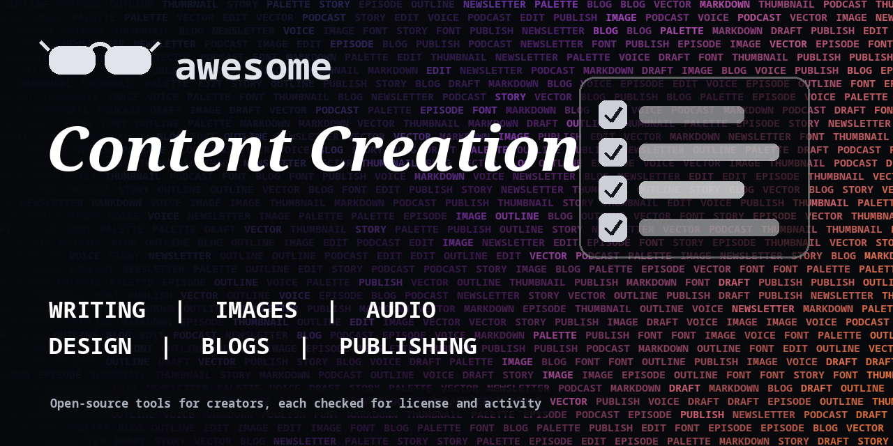

<h1 align="center">Awesome Content Creation</h1>

> Open-source tools for writers, designers, podcasters and creators: writing, images, audio, design, blogging and publishing. Every entry shows its license.

**Rules of this list:** every repo exists, is public, is not archived, states a license and has had a commit in the last year. One plain sentence each. Star counts and claims are the authors' own, we did not test every tool. Checked 2026-10-18. See [CONTRIBUTING.md](CONTRIBUTING.md).

## Contents

- [Writing and editing](#writing-and-editing)
- [AI writing and research](#ai-writing-and-research)
- [Image creation and editing](#image-creation-and-editing)
- [Design, graphics and diagrams](#design-graphics-and-diagrams)
- [Podcast and audio](#podcast-and-audio)
- [Blogging and CMS](#blogging-and-cms)
- [Newsletters and email publishing](#newsletters-and-email-publishing)
- [Notes, planning and knowledge](#notes-planning-and-knowledge)
- [Fonts, icons and free media tooling](#fonts-icons-and-free-media-tooling)
- [How to choose](#how-to-choose)
- [Contributing](#contributing)

## Writing and editing

Editors, grammar tools and long-form writing apps.

- [ianstormtaylor/slate](https://github.com/ianstormtaylor/slate)  - Customizable framework for building rich text editors. _(MIT)_
- [languagetool-org/languagetool](https://github.com/languagetool-org/languagetool)  - Open-source grammar, style and spell checker for many languages. _(LGPL-2.1)_
- [laurent22/joplin](https://github.com/laurent22/joplin)  - Note-taking and to-do app with sync and end-to-end encryption. _(check repo)_
- [logseq/logseq](https://github.com/logseq/logseq)  - Privacy-first outliner and knowledge base. _(AGPL-3.0)_
- [marktext/marktext](https://github.com/marktext/marktext)  - Simple and elegant Markdown editor for desktop. _(MIT)_
- [outline/outline](https://github.com/outline/outline)  - Fast, collaborative team knowledge base. _(check repo)_
- [streetwriters/notesnook](https://github.com/streetwriters/notesnook)  - End-to-end encrypted note-taking app. _(GPL-3.0)_
- [toeverything/AFFiNE](https://github.com/toeverything/AFFiNE)  - Workspace that combines docs, whiteboards and databases. _(check repo)_
- [TriliumNext/Trilium](https://github.com/TriliumNext/Trilium)  - Hierarchical note-taking app for building a large personal knowledge base. _(AGPL-3.0)_
- [TriliumNext/Trilium](https://github.com/TriliumNext/Trilium)  - Maintained continuation of Trilium Notes, a hierarchical note-taking app. _(AGPL-3.0)_
- [ueberdosis/tiptap](https://github.com/ueberdosis/tiptap)  - Headless rich text editor framework for the web. _(MIT)_
- [vale-cli/vale](https://github.com/vale-cli/vale)  - Command-line prose linter with customizable style rules. _(MIT)_

## AI writing and research

LLM tools for drafting and research. Always edit the output yourself.

- [langgenius/dify](https://github.com/langgenius/dify)  - Platform for building LLM apps with workflows and RAG. _(check repo)_
- [ollama/ollama](https://github.com/ollama/ollama)  - Run large language models locally. _(MIT)_
- [open-webui/open-webui](https://github.com/open-webui/open-webui)  - Self-hosted web interface for local and hosted language models. _(check repo)_
- [Significant-Gravitas/AutoGPT](https://github.com/Significant-Gravitas/AutoGPT)  - Platform for building and running AI agents that automate work. _(check repo)_

## Image creation and editing

Image editors and generation front ends.

- [AUTOMATIC1111/stable-diffusion-webui](https://github.com/AUTOMATIC1111/stable-diffusion-webui)  - Web interface for Stable Diffusion image generation. _(AGPL-3.0)_
- [Comfy-Org/ComfyUI](https://github.com/Comfy-Org/ComfyUI)  - Node-based interface for image, video and audio generation models. _(GPL-3.0)_
- [danielgatis/rembg](https://github.com/danielgatis/rembg)  - Remove image backgrounds with a command-line tool or library. _(MIT)_
- [GNOME/gimp](https://github.com/GNOME/gimp)  - Cross-platform image editor, GNU Image Manipulation Program. _(check repo)_
- [huggingface/diffusers](https://github.com/huggingface/diffusers)  - Library of pretrained diffusion models for images, audio and video. _(Apache-2.0)_
- [invoke-ai/InvokeAI](https://github.com/invoke-ai/InvokeAI)  - Creative engine for Stable Diffusion models with a polished web UI. _(Apache-2.0)_
- [KDE/krita](https://github.com/KDE/krita)  - Free digital painting program. _(GPL-3.0)_
- [lllyasviel/Fooocus](https://github.com/lllyasviel/Fooocus)  - Simple image generation tool built on Stable Diffusion XL. _(GPL-3.0)_

## Design, graphics and diagrams

Vector tools, mockups and diagrams.

- [blender/blender](https://github.com/blender/blender)  - Free and open-source 3D creation suite. _(check repo)_
- [excalidraw/excalidraw](https://github.com/excalidraw/excalidraw)  - Virtual whiteboard for sketching hand-drawn style diagrams. _(MIT)_
- [jgraph/drawio](https://github.com/jgraph/drawio)  - Diagramming tool that runs in the browser or as a desktop app. _(Apache-2.0)_
- [mermaid-js/mermaid](https://github.com/mermaid-js/mermaid)  - Generate diagrams from text, like Markdown for charts. _(MIT)_
- [penpot/penpot](https://github.com/penpot/penpot)  - Open-source design and prototyping platform for design and code teams. _(MPL-2.0)_
- [plantuml/plantuml](https://github.com/plantuml/plantuml)  - Create diagrams from plain text descriptions. _(LGPL-3.0)_
- [tldraw/tldraw](https://github.com/tldraw/tldraw)  - Infinite canvas SDK and whiteboard app. _(check repo)_

## Podcast and audio

Record, edit and publish audio.

- [audacity/audacity](https://github.com/audacity/audacity)  - Free, cross-platform audio editor and recorder. _(check repo)_
- [AzuraCast/AzuraCast](https://github.com/AzuraCast/AzuraCast)  - Self-hosted web radio and podcast station. _(AGPL-3.0)_
- [openai/whisper](https://github.com/openai/whisper)  - General-purpose speech recognition model. _(MIT)_

## Blogging and CMS

Sites and CMS for publishing.

- [11ty/buildawesome](https://github.com/11ty/buildawesome)  - Simple static site generator in JavaScript. _(MIT)_
- [directus/directus](https://github.com/directus/directus)  - Data platform and headless CMS for any SQL database. _(check repo)_
- [getpelican/pelican](https://github.com/getpelican/pelican)  - Static site generator in Python. _(AGPL-3.0)_
- [gohugoio/hugo](https://github.com/gohugoio/hugo)  - Fast static site generator written in Go. _(Apache-2.0)_
- [jekyll/jekyll](https://github.com/jekyll/jekyll)  - Blog-aware static site generator, used by GitHub Pages. _(MIT)_
- [keystonejs/keystone](https://github.com/keystonejs/keystone)  - Headless CMS and GraphQL API for Node.js. _(MIT)_
- [payloadcms/payload](https://github.com/payloadcms/payload)  - Headless CMS and app framework built with TypeScript and Next.js. _(MIT)_
- [sanity-io/sanity](https://github.com/sanity-io/sanity)  - Real-time headless CMS with a customizable studio. _(MIT)_
- [strapi/strapi](https://github.com/strapi/strapi)  - Open-source headless CMS in JavaScript. _(check repo)_
- [TryGhost/Ghost](https://github.com/TryGhost/Ghost)  - Professional publishing platform for blogs and newsletters. _(MIT)_
- [wagtail/wagtail](https://github.com/wagtail/wagtail)  - Django-based CMS focused on flexibility and editor experience. _(BSD-3-Clause)_
- [withastro/astro](https://github.com/withastro/astro)  - Web framework for content-driven sites. _(check repo)_
- [WordPress/WordPress](https://github.com/WordPress/WordPress)  - The WordPress content management system. _(check repo)_

## Newsletters and email publishing

Send and grow a newsletter.

- [knadh/listmonk](https://github.com/knadh/listmonk)  - Self-hosted newsletter and mailing list manager. _(AGPL-3.0)_
- [mautic/mautic](https://github.com/mautic/mautic)  - Open-source marketing automation including email campaigns. _(check repo)_
- [phpList/phplist3](https://github.com/phpList/phplist3)  - Open-source newsletter and email campaign manager. _(AGPL-3.0)_
- [usesend/useSend](https://github.com/usesend/useSend)  - Open-source email sending for products and newsletters. _(AGPL-3.0)_

## Notes, planning and knowledge

Capture ideas and organize projects.

- [AppFlowy-IO/AppFlowy](https://github.com/AppFlowy-IO/AppFlowy)  - Open-source Notion alternative built with Flutter and Rust. _(AGPL-3.0)_
- [makeplane/plane](https://github.com/makeplane/plane)  - Open-source project management tool for tasks, cycles and docs. _(AGPL-3.0)_
- [nextcloud/server](https://github.com/nextcloud/server)  - Self-hosted cloud for files, calendar, contacts and docs. _(AGPL-3.0)_
- [siyuan-note/siyuan](https://github.com/siyuan-note/siyuan)  - Privacy-first personal knowledge management system. _(AGPL-3.0)_
- [usememos/memos](https://github.com/usememos/memos)  - Self-hosted, lightweight note-taking service. _(MIT)_

## Fonts, icons and free media tooling

Libraries that help you ship good-looking work.

- [adobe-fonts/source-code-pro](https://github.com/adobe-fonts/source-code-pro)  - Open-source monospaced font family from Adobe. _(OFL-1.1)_
- [google/material-design-icons](https://github.com/google/material-design-icons)  - Material Design icons from Google. _(Apache-2.0)_
- [lucide-icons/lucide](https://github.com/lucide-icons/lucide)  - Community-run icon library, a fork of Feather. _(check repo)_
- [tabler/tabler-icons](https://github.com/tabler/tabler-icons)  - Free, open-source SVG icons with an MIT license. _(MIT)_
- [twbs/icons](https://github.com/twbs/icons)  - Official open-source SVG icon library for Bootstrap. _(MIT)_

## How to choose

- **Credit your sources.** Open-source tools can still output things you need to credit or clear.
- **Disclose AI use** where your platform or audience expects it.
- **Edit AI drafts.** Facts and tone need your check.
- **Check the license** before you use a tool or its output for client work.

## Contributing

See [CONTRIBUTING.md](CONTRIBUTING.md). One entry per pull request, plain words, real sources only.

## About

Maintained by [@devanasolver](https://github.com/devanasolver). Listings follow the rules in CONTRIBUTING.

## Sponsor me

If this list is useful, [buy me a coffee](https://buymeacoffee.com/isaac49).
